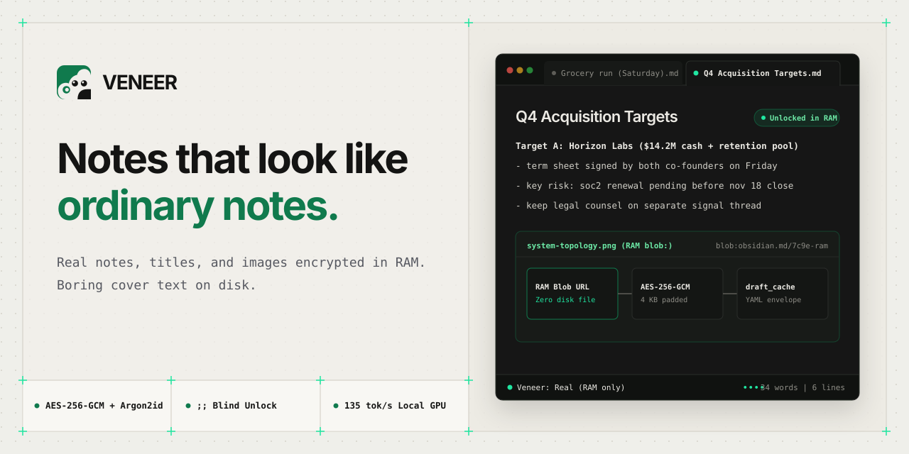
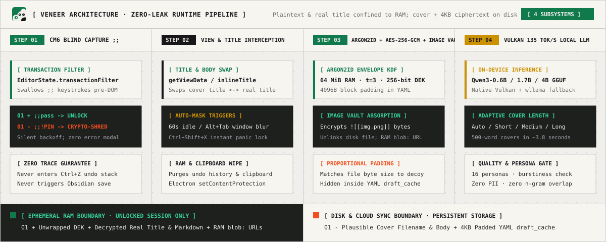

<p align="center">
  
</p>

<table>
  <tr>
    <td width="80" align="center" valign="middle">
      
    </td>
    <td valign="middle">
      <strong>Veneer: Notes that look like ordinary notes.</strong><br/>
      <em>"Someone looks over your shoulder? They see a boring grocery list. Type <code>;;</code> and your password on any line? Your real note, real title, and hidden images appear in RAM. Switch tabs or walk away, and the cover comes right back."</em>
    </td>
  </tr>
</table>

<p align="center">
  <a href="docs/TUTORIAL.md"><strong>Hands-On Tutorial</strong></a> · <a href="docs/ARCHITECTURE.md"><strong>Architecture &amp; Threat Model</strong></a> · <a href="docs/QA.md"><strong>QA Checklist</strong></a>
</p>

---

## Why Lock Screens Fail (And How Veneer Fixes It)

Traditional encryption plugins put a giant padlock on your file. That protects the ciphertext, but it announces to anyone looking at your screen, your sidebar, or your attachment folder that you are hiding something important. Veneer removes the tells.

| The Tell | Standard Encrypted Note Plugins | Veneer |
| :--- | :--- | :--- |
| **1. The "Locked File" Tell** | Clicking the note pops up an obvious password modal or displays a block of raw base64 ciphertext. | Opens directly as an ordinary, readable note (a grocery list, meeting notes, or a debug log). No modal, no lock icon, and no error shake on a wrong password. |
| **2. The Filename Leak** | The body is encrypted, but `Seed Term Sheet.md` sits in plain sight in your sidebar and OS file explorer. | Renames the file on disk to match the cover title (e.g., `Weekend Errands.md`). Your real title is encrypted inside the payload and restored in RAM only while unlocked. |
| **3. The Pasted Screenshot Leak** | Text is encrypted, but `Pasted image 20260415.png` stays unencrypted right inside your vault folder. | Absorbs local `![[image.png]]` files into the AES-256-GCM payload, deletes the unencrypted copies from disk, and renders them inline via in-memory `blob:` URLs while unlocked. |
| **4. The Auto-Save & Search Leak** | Decrypting a note in place lets Obsidian's auto-save, global search index, or File Recovery snapshot plaintext to disk. | Intercepts `MarkdownView` save paths so disk writes always serialize the decoy body + encrypted `draft_cache` YAML frontmatter. Global search, graph view, and backlinks only ever index the cover. |

---

## How It Works in 4 Steps

### `01. Pick or generate a cover`
Run `Veneer: Protect this note` from the Command Palette or right-click menu. Choose one of **12 instant templates** (grocery list, sprint retro, debug log, workout log, and more) or generate a custom, persona-aware cover on-device (`Auto`, `Short ~50w`, `Medium ~200w`, `Long ~500w`). On Windows with a compatible GPU, Veneer uses a local `llama-server` Vulkan runtime (~135 tokens/sec on an RTX 4050, generating a 500-word multi-section cover in ~4 seconds) and falls back automatically to single-threaded `wllama` WebAssembly when needed. Every generated cover is scored for burstiness, human shorthand, and zero n-gram overlap with your real note.

### `02. Type ;; + password on any line`
To unlock a protected note, click at the start of any line and type `;;` followed by your password and `Enter` (or `Space`). A CodeMirror 6 `transactionFilter` intercepts and swallows every character before it can enter the editor document state, DOM, or `Ctrl+Z` undo history. Subtle `••••` dots in the bottom-right status bar confirm capture is active. If you prefer a dialog, `Veneer: Unlock this note` opens a password prompt with a `Show / Hide` toggle.

### `03. Edit normally in RAM`
Once Argon2id derives your key (~300 ms), your real text, original note title, and embedded images appear in the editor. Edit, type, and paste new screenshots naturally. Every debounced auto-save re-encrypts the RAM buffer with a fresh 96-bit AES-256-GCM nonce, pads the payload to **4 KB blocks**, absorbs any newly pasted vault images into the encrypted bundle, and writes only the cover note and `draft_cache` frontmatter to disk.

### `04. Walk away, it masks itself`
Stop typing for 60 seconds, switch tabs, `Alt+Tab` to another window, lock your OS screen, or hit the `Ctrl+Shift+X` panic chord: Veneer immediately flushes pending edits to the encrypted payload, revokes active `blob:` image URLs, wipes the CodeMirror undo history so `Ctrl+Z` cannot resurrect your real text, clears tracked clipboard text, and swaps the cover title and decoy body back in. In an emergency, typing `;;!` + your **Destruction PIN** at any line start crypto-shreds all protected payloads across your vault in one pass.

---

## 60-Second Install & Quickstart

### Build & Install from Source

```bash
git clone https://github.com/farizanjum/vener.git
cd vener
npm install
npm run build

# Copy the built plugin into your Obsidian vault:
# Copy main.js, manifest.json, styles.css, and assets/ into:
# <your-vault>/.obsidian/plugins/deocy/
```

### 3-Step First-Run Checklist

1. **Disable Core File Recovery (Required):** Open **Settings -> Core plugins** in Obsidian and turn off **File Recovery**. File Recovery snapshots in-memory editor buffers to disk; Veneer enforces this check and blocks unlocking until File Recovery is disabled.
2. **Set Your Cover Persona & Interests:** Open **Settings -> Veneer** and add a one-line **Cover persona** (for example, `"backend developer who plays cricket and cooks on weekends"`) plus a few comma-separated **Cover interests**. On-device generation uses these to make decoys match your everyday life without ever reading your other vault notes.
3. **Protect Your First Note:** Open any note, press `Ctrl+P`, and run **Veneer: Protect this note**. Pick an instant template or click **Generate** with your preferred cover length (`Auto`, `Short`, `Medium`, or `Long`), set a password, and watch your note transform into an ordinary cover file.

For a complete walkthrough of every feature, read the **[Hands-On User Tutorial](docs/TUTORIAL.md)**.

---

## Architecture & Project Structure

<p align="center">
  
</p>

See **[docs/ARCHITECTURE.md](docs/ARCHITECTURE.md)** for the deep-dive technical specification, cryptographic envelope format, session state machine, and edge-case catalog, and **[docs/QA.md](docs/QA.md)** for the live-vault verification checklist.

```text
src/
  main.ts                 Plugin entry, command registration, event wiring
  settings.ts             Settings schema, model catalog, active model resolver
  registry.ts             Protected-note registry and rename tracking
  crypto/
    crypto.ts             Argon2id KDF, AES-256-GCM DEK/KEK wrapping, 4 KB block padding
    payload.ts            YAML frontmatter (draft_cache) parser, serializer, file-size matching
    images.ts             Vault image absorption and permanent restoration
  view/
    session.ts            Per-view locked/unlocked RAM session state machine
    patch.ts              MarkdownView save interception and history replacement
    save.ts               Save-path decision logic (locked vs. unlocked buffer routing)
    imageWidget.ts        CodeMirror 6 widget rendering decrypted images via RAM blob: URLs
  capture/
    UnlockCapture.ts      CodeMirror 6 transactionFilter for ;;password and ;;!PIN capture
  lock/
    LockEngine.ts         Idle timer, blur, tab-switch, and Ctrl+Shift+X panic orchestration
    clipboard.ts          Clipboard hash tracking and auto-wipe on mask
    contentProtection.ts  Electron setContentProtection screen-capture shield
    power.ts              OS lock/suspend listeners and web storage cleanup
  decoy/
    wizard.ts             Protect-this-note modal wizard with live cover preview
    templates.ts          12 built-in parameterized cover templates
    title.ts              Cover title extraction and safe file renaming
    strength.ts           Password entropy and feedback scoring
  llm/
    nativeRuntime.ts      Windows Vulkan GPU runtime via local llama-server
    runtime.ts            Single-thread wllama WebAssembly fallback runtime
    preferredRuntime.ts   Automatic GPU-to-WASM runtime selector
    generator.ts          Decoy generation pipeline and retry loop
    prompt.ts             Persona-aware prompts and adaptive cover length targets
    validate.ts           Burstiness, AI cliche, PII, and n-gram overlap validator
    download.ts           Resumable model downloader with SHA-256 verification
  shred/
    duress.ts             RAM-first emergency crypto-shredding orchestrator
    pin.ts                Argon2id Destruction PIN hashing and verification
    hygiene.ts            Vault and OS security hygiene checks
  ui/
    settingsTab.ts        Plugin settings, model manager, hygiene checklist, VeraCrypt guide
    downloadModal.ts      Pause/resume GGUF download modal
    modals.ts             Password unlock/change modals (with Show/Hide) and PIN setup modal
    statusBar.ts          Capture progress dots and (cover)/(real) word counter
```

### Development Commands

```bash
npm install        # Install dependencies
npm run build      # Build production bundle + copy WASM assets
npm test           # Run Vitest suite
npm run typecheck  # Strict TypeScript check
npm run dev        # Watch mode for local development
```

---

## Honest Threat Model

> **Does Veneer provide disk-forensic immunity on its own?**
> No. Veneer is built for **screen-level and application-level plausible deniability**: it defeats people looking at your screen, browsing your open laptop, or casually inspecting your cloud-synced vault. It does **not** defeat a forensic examiner imaging your raw SSD.

### What Veneer Defeats
- **Shoulder-surfers and coworkers** glancing at your monitor in an office, cafe, or flight.
- **Friends, family, or roommates** borrowing your unlocked laptop or clicking around your Obsidian sidebar.
- **Opportunistic device theft** when your laptop is snatched while open (window blur and lock triggers mask open notes immediately).
- **Casual corporate IT or cloud sync inspection** (OneDrive, Google Drive, iCloud, and git only receive the cover filename, decoy body, and AES-256-GCM ciphertext inside `draft_cache`).
- **Compelled quick unlocks** where you need to either keep sensitive notes looking mundane or trigger `;;!PIN` to shred all encrypted payloads into plain cover files.

### What Requires VeraCrypt & OS-Level Hygiene
- **Raw disk imaging and forensic carving:** The presence of `.obsidian/plugins/deocy/` on disk proves Veneer is installed. Furthermore, Windows pagefiles (`pagefile.sys`), hibernation files (`hiberfil.sys`), NTFS USN journals, and Electron crash dumps exist outside any plugin's control.
- **Cloud version history of previously plaintext notes:** If a note was synced to the cloud *before* you protected it with Veneer, old plaintext revisions remain in your cloud provider's version history. Always create sensitive notes fresh inside a local folder or purge cloud version history after protecting.
- **Other untrusted Obsidian community plugins:** All plugins share the same Electron renderer process and can inspect active editor buffers while a note is unlocked. Keep your installed plugin list minimal and trusted.

For high-risk scenarios requiring disk-level plausible deniability, store your entire vault and portable Obsidian installation inside a **VeraCrypt hidden volume** (full step-by-step instructions are built directly into **Settings -> Veneer -> VeraCrypt guide**).

---

## License

MIT.
